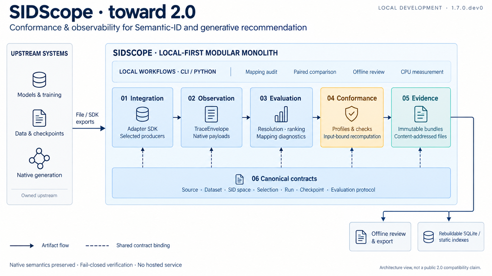

# SIDScope System Architecture

## Current implementation view — 2026-10-08

The `2.0.0` package retains the **frozen 1.7 implementation architecture**.
The existing illustration and content map remain unchanged 1.7 baseline
artifacts; the package version is reported separately by the verifier. Owner
authorization for independent publication is ADR-0028, not a diagram.
The six owned layers are implemented; a diagram of
their existence does not establish every route, workload or user acceptance.
Requirement states come from `reproducibility/sidscope_sdlc_requirements.csv`.



[Architecture content map](figures/sidscope-current-architecture.json) ·
[Image-generation prompt](figures/sidscope-current-architecture-prompt.md).
The raster overview was produced with built-in image generation, not draw.io.
The interface does not expose a model version; no specific "image 2.5" model
claim is made. Solid arrows show logical artifact flow, not Python imports or
separate services. Dashed arrows show shared canonical identity/contract binding.
Contracts are drawn as the foundation, not a sequential processing stage.
The dependency matrix remains the authority for allowed imports. Workflow
consumers use existing APIs; they do not add a seventh product layer. Numbering
is local to the visual layout, not a new dependency or compatibility ordering.

### From user workflow to delivered code

| Surface | Current code | Responsibility and boundary |
| --- | --- | --- |
| Explicit native execution | `tools/observe_sidscope_native_runtime.py` | Caller-authorized scratch observation; imports upstream code only in its own environment. No training or submission-selected execution. |
| Generic producer entry | `src/sidscope/pipeline.py`, `src/sidinspector/sdk/` | Caller selects an AdapterHarness producer; provenance/run/family bindings are checked. A run spec supplies paths, not executable code. |
| RPG/PSID observed-data bridge | `tools/build_sidscope_native_submission.py` | Existing observations and extracted metadata become canonical objects and diagnostic submissions; no model or key access. |
| Canonical identity and trace | `src/sidinspector/contracts/`, `schemas/`, `trace/` | Versioned identity, EvaluationProtocol, TraceEnvelope and native payloads. Never invent AR order for RPG or erase masked/latent state. |
| Mapping-first audit (N06) | `src/sidscope/mapping_check.py` | Catalog/split/target/SID joins; conditional diagnostics use explicit train interactions. Missing prerequisites stay unavailable. |
| Evaluation and admission | `src/sidinspector/evaluation/`, `evidence/recomputation.py`, `conformance_core/`, `submission/` | Recompute input-bound diagnostics and result cards. Current diagnostic admission says `diagnostics_verified`, not training verification or named-adapter promotion. |
| Immutable evidence | `src/sidinspector/evidence/` | Bundles and content-addressed files are authoritative; SQLite and static indexes are rebuildable projections. Corrections supersede, never rewrite history. |
| Matched-run comparison (N05) | `src/sidscope/regression.py` | Matched runs and shared user clusters; bounded uncertainty and degradation budgets. One observation is not multiple seeds. |
| Actionable offline report (N04) | `src/sidscope/diagnostic_review.py` | Recomputed findings, slices, pseudonymous examples, evidence pointers and next checks; no server or causal promotion. |
| One-command observed workflow (N01 technical path) | `tools/run_sidscope_observed_review.py` | Canonical/mapping admission → original-input rebuild → rank evaluation → offline review. Unsupported duplicate ranked slots fail explicitly, without changing native evidence. |
| CPU cost measurement (N08) | `tools/benchmark_sidscope_observed_review.py` | Fresh subprocesses measure phase time, process RSS and output bytes; native NFE retains its separate observation scope. Not a new persistent worker service. |
| SID refresh lifecycle (N07) | `src/sidscope/refresh.py`, `tools/verify_sidscope_sid_refresh.py` | Explicit ordered-prefix, parallel-position or unordered-set comparison; separates raw churn from common-item structure and optionally binds recomputed downstream evidence. No repair or causal claim. |

`src/sidscope/workflows.py` exposes local audit/evaluate/compare workflows.
These opt-in modules do not silently enlarge the curated facade compatibility
promise. Core verification does not import a producer merely because it is named
in an input artifact.

### Acceptance snapshot and next boundary

- N02-N08 have verified engineering implementations in the ledger. N08 is closed
  at exactly 100 episodes per approved RPG/PSID route: transferred inputs passed
  hash/validation checks and three local postprocessing repeats. No model rerun,
  1000-episode trace or production SLO is in scope.
- N07 is delivered under ADR-0022. Actual-shape same-input controls pass on the
  12,101-item RPG parallel-position mapping and 17,396-item PSID ordered-prefix
  mapping. They verify the zero-change invariant, not a real refresh experiment.
- Adapter SDK 1.0 and the pre-2.0 compatibility surface are frozen by ADR-0023/0024.
  N09/N10 remain deferred and no hosted/training surface is introduced.
- Independent user actual use is excluded from current gates by ADR-0025; the
  adoption fact stays not verified. Certification additionally requires
  same-source delivery evidence; automated tests, maintainer reruns and
  synthetic installed consumers never certify delivery or adoption by themselves.

### Maintaining this view

Architecture documentation and diagram ownership stays with the core/Evidence
maintainer in `CODE_OWNERSHIP.md`. This view documents ADR-0019–0024; it changes
no topology, contracts, runtime defaults or public authority, so no new topology
ADR or migration is needed. Sections 3 and 8–11 retain alternatives, concrete
technology, operations, failure modes and rollback decisions. No hosted service,
automatic SID repair, new algorithm or streaming subsystem is added here.

The content map carries code paths, six owned layers and the logical edge types.
`tools/verify_sidscope_architecture_inventory.py` checks paths, layer coverage,
local-development scope, edge structure and map/prompt/image checksums in the
existing architecture inventory. These checks cannot prove that generated pixels
match the content map: `pixel_semantics_checked` remains false. Requirement
states belong to the ledger and prose, not to the illustration. To refresh the
image, use the saved prompt with image generation, inspect every label and arrow,
then replace the PNG and run:

```sh
python3 tools/build_sidscope_architecture_inventory.py
python3 tools/verify_sidscope_architecture_inventory.py
```

Inspect the generated preview before accepting a refresh. No image-generation
runtime dependency is added to SIDScope. Figure map/prompt/preview ship in
conformance/evidence-full, not the minimal runtime profile; the existing inventory
is included through the established conformance tooling dependency. Source or
documentation edits invalidate earlier exact-source delivery receipts; perform
new delivery checks before making a new release-ready claim.

## Historical integration notes (superseded by the current view above)

ADR-0021 adds opt-in local `sidscope.regression` and `sidscope.diagnostic_review`
modules: paired run/user-cluster statistics, recomputed evidence-addressed HTML,
and a one-command observed-input workflow. NumPy and standard-library rendering
stay in the same process; CPU benchmark workers isolate peak RSS. No new service,
stable facade symbol or canonical schema is introduced. Existing five-episode
observations cannot establish larger-trace scale or independent user adoption.

The chronological integration notes below are historical; ADR-0020/0021 supersede
earlier statements that the two canonical bridges are unimplemented.

ADR-0020 adds the optional pure-data native canonical bridge, reusing SDK and
existing contracts/admission/comparison. Actual RPG and PSID observations now
export canonical envelopes and diagnostic EvidenceBundle submissions. Full data
remain external; named-adapter/independent-use claims remain separate. The only
core repairs are exact boolean validation and contract-validated normalization
privacy declarations; no public schema, facade, payload or runtime topology changes.

The caller-authorized CPU scratch observer is separate from the offline native
observation verifier (ADR-0019). Only the former imports external runtime code and
uses private assets; public submissions cannot select or invoke it. The latter
binds normalized exports, targets, measurements and full mapping joins through
existing kernels. Its developmental receipt is not canonical bundle admission.
No public schema/facade, service topology or upstream generation semantics change.

Native rank projection remains a synchronous evidence-full tool reusing native
validators and the existing diagnostic metric kernel (ADR-0019). It executes no
producer code and opens no cache or identity key. Absent generation/compute facts
are not coerced into TraceEnvelope fields. Real observation and canonical bundle
integration remain separate uncompleted work; no runtime topology is added.

ADR-0019 adds synchronous caller-selected producer orchestration and normalized
mapping preflight within the existing modular monolith. No executable code may
be selected by a submission/run spec. D3/D4 consume only explicit train events;
missing joins remain unavailable. The two real canonical producer integrations
are not established by generic orchestration or fixture-based installed tests.

Local input policy (ADR-0018): trusted local workflow and export inspection use
optional caller budgets, independent of bounded untrusted submission intake.
Structural validation and native generation semantics remain unchanged. Existing
in-memory metric kernels and the modular monolith are retained. Independent
subprocess profiling records CPU phase times, peak RSS and output bytes; evidence
of an actual workload bottleneck, not arbitrary row caps, governs future streaming.

Status: approved target architecture

Implementation warning: the target trust chain is not yet independently closed.
ADR-0016 separates structural replay from computation-bound diagnostic admission.
The fixed EvaluationProtocol binds population and metric definitions to recomputed
result cards. `SIDSCOPE_SDLC_HARDENING.md` tracks remaining independent-user acceptance work. No new service
or upstream training responsibility is introduced.

Verification is computation-only: execute necessary feasible input-bound checks;
otherwise leave the claim unverified. CPU is sufficient for trace-based metric
recomputation; Fudan is an execution venue for necessary native inference, not a
new service or evidence authority. Human signatures do not replace computation.

Applies to: post-`1.1.1` development through `2.0`

Publication boundary: the architecture is implemented on the local
`codex/sidscope-v2` line. Public GitHub remains on maintained 1.1.x, and the
TOIS submission remains an independently frozen package, until separate
promotion or revision decisions are explicitly authorized.

Product position: conformance and observability for Semantic-ID and generative recommender systems

## 1. Decision Summary

SIDScope is the conformance and observability layer between an upstream
recommender implementation and a reviewable evidence record. It standardizes
how an implementation declares identities, exports native execution state,
computes bounded diagnostics, proves conformance, and packages immutable
evidence.

SIDScope does not own or reimplement upstream recommendation methods or
training. It does not replace official training pipelines, RecBole, TorchRec,
Transformers, or project-specific model code. Those systems may call SIDScope
exporters or be wrapped by a SIDScope adapter, but model architecture,
optimization, checkpoint production, and serving remain upstream
responsibilities.

The chosen runtime shape through 2.0 is a local-first modular monolith:

- one installable Python distribution;
- one stable `sidscope` CLI facade while retaining the `sidinspector` import;
- six core modules with inward, acyclic dependencies;
- optional adapters discovered through Python package entry points;
- file-first, hash-bound interchange with upstream runtimes;
- a content-addressed evidence object store plus a rebuildable SQLite index;
- deterministic static exports for public release, not an always-on service.

The accepted product-boundary and topology decisions are recorded in
`adr/0001-product-boundary.md` and `adr/0002-local-first-modular-platform.md`.
ADR 0003 defines canonical identity, versioning and hashing; ADR 0004 defines
module boundaries and the stable CLI/import identity; ADR 0005 makes the local
contract registry authoritative and separates complete DatasetIdentity from
honest legacy-partial migration; ADR 0006 separates SID space from prepared
data; ADR 0007 fixes the execution/report boundary and Adapter SDK alpha without
absorbing upstream training. The executable dependency
policy is `reproducibility/sidscope_module_dependencies.json`, documented in
`SIDSCOPE_MODULE_DEPENDENCIES.md` and enforced by architecture tests.
ADR 0008 activates the lazy adapter-plugin boundary, five registered native
payload families, SDK 0.2 capability binding, and composable family profiles
without moving EvidenceBundle storage forward from 1.4. ADR 0009 makes
content-addressed evidence authoritative and SQLite derived. ADR 0010 separates
1.6 compatibility, migration and external-adoption hardening from the 2.0
stability declaration. ADR 0011 makes versioned profile reports the status
authority for new admissions and keeps the submission checker and generated
views deterministic, offline projections.
ADR 0015 separates the public 1.1.x maintenance authority, the local pre-2.0
development authority, and the exact-ref TOIS submission authority. It prevents
local architecture closure from implying GitHub publication or manuscript
revision.

## 2. System Context

### 2.1 Problem

The 1.1 line proves that method-faithful adapter verification is possible, but
its contracts and verifiers grew route by route. Without a shared architecture,
adding more methods would multiply schema dialects, one-off CLIs, status prose,
and migration risk. Conversely, absorbing upstream training would turn
SIDScope into a smaller model framework and weaken its evidence focus.

The system goal is therefore to make heterogeneous recommendation methods
auditable and comparable without changing their native semantics or taking
ownership of their training runtimes.

### 2.2 Actors and Responsibilities

| Actor | Responsibility | SIDScope relationship |
| --- | --- | --- |
| Method maintainer | Owns official source, model semantics, training and decoding behavior. | External provider; may publish an adapter or exporter. |
| Dataset or experiment owner | Owns raw data, split, private identities, checkpoints and full traces. | Produces bounded, deidentified contracts and evidence. |
| Adapter author | Maps one upstream method to SIDScope without altering it. | Uses the Adapter SDK and fixtures. |
| SIDScope maintainer | Owns canonical contracts, profiles, core verifier, packaging and releases. | Maintains the trusted core. |
| Reviewer or downstream consumer | Verifies bundles and compares compatible results. | Uses CPU-only CLI/API without upstream assets. |

### 2.3 Capability and System-of-Record Map

| Capability | System of record | Owner | Boundary |
| --- | --- | --- | --- |
| Method source and behavior | Pinned upstream repository and declared patch set | Method maintainer | External source/runtime boundary |
| Raw data and private split identities | Dataset or experiment workspace | Dataset/experiment owner | Restricted data boundary |
| Full checkpoint and trace | Upstream or downstream experiment store | Evidence producer | Restricted asset boundary |
| Adapter capability declaration | Versioned adapter package | Adapter author | Plugin boundary |
| Canonical schemas and profile definitions | SIDScope release | SIDScope maintainer | Stable product contract |
| Conformance outcome | Versioned SIDScope verifier report | SIDScope maintainer | Trusted verification boundary |
| Admitted evidence bundle | Content-addressed SIDScope evidence store | SIDScope maintainer | Immutable evidence boundary |
| Public result index | Deterministic export derived from admitted bundles | SIDScope release process | Public distribution boundary |
| License status | Audited upstream artifact plus dated clarification | Upstream author is legal authority; SIDScope records metadata | Reuse/redistribution boundary |

SIDScope is authoritative only for its contract, verification, and evidence
records. It does not become authoritative for upstream code, raw data,
checkpoints, or legal permissions merely by recording their identities.

### 2.4 Scope

In scope through 2.0:

- Adapter SDK and capability declarations;
- canonical identity and artifact contracts;
- method-faithful trace protocol;
- deterministic resolution, ranking, diagnostics and compute accounting;
- versioned conformance profiles and fail-closed verification;
- immutable evidence bundles, local registry, comparison and static publication;
- CLI/API, schema compatibility, privacy and release governance.

Intentionally out of scope:

- tokenizer or generator model implementation;
- general-purpose training orchestration;
- distributed embedding tables, sharding or production serving;
- hosted multi-tenant control plane or availability SLA;
- redistributing excluded upstream code, data, checkpoints or caches;
- rewriting frozen paper evidence under newer schemas.

## 3. Options Considered

| Option | Summary | Advantages | Costs and risks | Decision |
| --- | --- | --- | --- | --- |
| A. Continue route-specific scripts | Add each method with its own schema, exporter and verifier. | Lowest immediate refactor cost; preserves current commands. | Contract drift, duplicated validation, manual status updates, difficult third-party onboarding. | Rejected as the long-term shape; retained only as the 1.1 compatibility baseline. |
| B. Local-first modular platform | Shared contracts, evaluator, verifier and evidence modules; adapters remain plugins or built-ins; file-first interchange. | Preserves CPU/offline verification, provides stable extension points, minimizes operational burden and keeps upstream isolation. | Requires staged migration and exact regression against route-specific authorities. | Selected. |
| C. Hosted service platform | Network APIs, central database, job workers and online registry. | Central collaboration and potentially easier public browsing. | Creates availability, auth, tenancy, cost and on-call obligations before demand exists; risks executing untrusted upstream workloads. | Rejected through 2.0; static publication is sufficient. |

RecBole remains a developer-experience benchmark and an optional adapter
backend. OpenTelemetry is an architectural reference for a common envelope plus
native semantic payloads. MLPerf is a governance reference for versioned
profiles, checkers and evidence packages. None is a required runtime dependency.

## 4. Current, Interim and Target States

### 4.1 Historical Starting State: 1.1.1 Baseline

Method-specific modules and CLIs are the regression authorities. Shared
diagnostic utilities, release manifests and package gates exist, but schema
registration, plugin discovery, evidence indexing and cross-route comparison
are not yet unified. Status prose and machine-readable ledgers coexist.

This state is safe to exit only after every public fixture has an exact outcome
under the new facade and every existing evidence record remains addressable.

### 4.2 Interim State: 1.2 to 1.5 Coexistence

The shared core is introduced around the legacy verifiers rather than replacing
them all at once. The new CLI dispatches to versioned contracts and, where
necessary, compatibility wrappers around existing authorities. A route moves to
the shared verifier only after positive, negative, metric, hash and failure-code
parity passes.

During coexistence:

- legacy commands remain runnable and explicitly labeled;
- new schemas never silently reinterpret old traces;
- registry indexes are derived and rebuildable, never the only copy of evidence;
- each compatibility wrapper has an owner and retirement criterion;
- rollback means selecting the previous profile/CLI path, not rewriting a
  previously admitted bundle.

Version 1.5 adds a `submission` application-service module above the existing
owned layers. It orchestrates public contract, conformance and evidence APIs,
but owns none of their semantics and does not add a seventh product layer or a
deployable service.

### 4.3 Pre-Stable State: 1.6 Hardening, 1.7 Surface Stabilization, and Optional 1.8--1.9 Evolution

The 1.5 feature surface remains active while SIDScope proves multi-version
compatibility, migrates or archives every legacy authority, completes an
independent external-plugin onboarding, and verifies a compatible comparison
across generator families. No new owned product layer is introduced in this
state. A failing hardening gate returns to the last passing 1.5 profile/CLI
combination and delays 2.0 without rewriting immutable evidence.

Implementation status: 1.6 is development-closed in the existing modular
monolith. Executable artifacts now cover six compatibility axes, fifteen
legacy migration records and a deterministic status projection, isolated
external-plugin replay, cross-family compatible comparison, and the candidate
Python/CLI/wrapper inventory. No service, method runtime, mutable authority, or
additional product layer was introduced. These proofs must be rerun by the
final active 1.x release before 2.0.

Version 1.7 is activated as a bounded contract/public-surface stabilization
iteration, not an additional architecture layer. It makes every public schema
discoverable, orders structural before semantic validation, validates CLI
result envelopes, adds the curated `sidscope` integration facade, centralizes
semantic producer identities, and strengthens module-boundary fitness tests.
The runtime remains the same local-first modular monolith and all changes are
additive over the passing 1.6 rollback point.

Release packaging is also stabilized inside 1.7. One machine-readable registry
projects the same public manifest into strict `runtime < conformance <
evidence-full` views. This is a packaging boundary, not another runtime or
repository: the default installable view excludes tests, fixtures and evidence;
the conformance view adds compact development assets; the complete evidence
view preserves the audit corpus. Every archive binds its selected path set in a
deterministic receipt, so separation cannot silently drop or relabel evidence.

Versions 1.8--1.9 remain reserved optional iterations. An activated minor
release must have an approved bounded scope, retain the previous passing 1.x
rollback point, and rerun all applicable hardening criteria. If no further work
is justified after 1.7, SIDScope may proceed to 2.0 without placeholder tags.

### 4.4 Target State: 2.0

Adapters produce registered contracts and native trace payloads. The shared
evaluator and verifier derive diagnostics and status under a versioned profile.
Only passing conformance reports can create an admitted evidence bundle. Local
registry state is rebuilt from immutable bundles, and public indexes are static
exports from that same source.

Legacy route-specific verifiers may remain available for historical replay, but
they no longer define new status transitions after their profiles have migrated.

## 5. Logical Six-Layer Topology

### 5.1 End-to-End Flow

```text
External method / training runtime / private assets
                         |
                         | file or SDK boundary
                         v
1. Integration: Adapter SDK and capability declaration
                         |
                         v
2. Contract: identities, prepared data, selection, run and checkpoint
                         |
                         v
3. Observation: common trace envelope + native family payload
                         |
                         v
4. Evaluation: resolution, ranking, metrics, failure and compute decomposition
                         |
                         v
5. Conformance: versioned profile + fail-closed verifier
                         |
                         v
6. Evidence: immutable bundle -> local registry -> deterministic public index
```

SIDScope owns layers 1 through 6. This is the product-level flow; current
diagnostic admission is input-bound and scope-limited. A completed upstream run,
hash-only training record or computed metric alone cannot promote an adapter or
certify training. See the current implementation view for actual entrypoints.

### 5.2 Integration Styles

| Boundary | Style | Reason |
| --- | --- | --- |
| Upstream runtime to Adapter SDK | Python API when dependency-safe; otherwise explicit JSON/files | Keeps method execution in its own environment and avoids importing GPU stacks into the verifier. |
| Adapter to core contracts | Canonical JSON plus content hashes | Portable, inspectable and deterministic across projects. |
| CLI/API to core | In-process synchronous calls | Validation is local and deterministic; no broker or service is justified. |
| Evidence bundle to registry | Atomic local transaction into content-addressed objects and SQLite metadata | Bundles remain authoritative; the index can be rebuilt after corruption. |
| Registry to public release | Deterministic static JSON/CSV/Markdown export | No hosted database or online availability dependency. |

The external runtime boundary functions as an anti-corruption layer: upstream
field names and storage layouts stop at the adapter, while native method
semantics continue into the trace payload.

## 6. Owned Layers

### 6.1 Integration Layer: Adapter SDK

The Integration Layer is the only method-facing boundary. An adapter translates
upstream identities and native runtime events without changing model behavior.

It must:

- declare source, paper, revision, license marker, notices and patch identity;
- bind data, SID/tokenizer, model, sampling, command and checkpoint identities;
- export canonical prepared-data and explicit episode-selection artifacts;
- emit a registered method-family-native trace payload;
- expose deterministic CPU preflight and positive/expected-failure fixtures;
- declare capabilities and unsupported telemetry explicitly.

An adapter must not retrain a model, replace official decoding, synthesize
missing telemetry or silently normalize incompatible SID spaces. Recoverable
training bridges are integration utilities for provenance; they do not make
SIDScope a training framework.

### 6.2 Contract Layer: Canonical Artifacts

| Entity | Required purpose |
| --- | --- |
| `SourceIdentity` | Paper, repository, immutable revision, license marker, notices and explicit patch set. |
| `DatasetIdentity` | Dataset/category/profile plus train/validation/test identities, counts and hashes. |
| `SIDSpaceIdentity` | Tokenizer/codebook identity, positions, vocabulary/offsets, special tokens, hierarchy, collision and de-duplication semantics. |
| `PreparedDataset` | Normalized split, train-only catalog, canonical target universe, pseudonymous mapping and integrity hashes. |
| `EpisodeSelection` | Explicit ordered evaluation episodes and evaluator-only labels; no first-N fallback. |
| `RunIdentity` | Source, prepared data, configuration, seed, command, environment and training-manifest bindings. |
| `CheckpointBinding` | Model/optimizer/scheduler/RNG state identity plus epoch/global-step and resumable provenance. |
| `TraceEnvelope` | Common observation summary plus a hash-bound method-family-native payload. |
| `DiagnosticReport` | Metrics, failure decomposition, compute and censoring semantics. |
| `ConformanceReport` | Profile, gate outcomes, typed failures, verifier identity and verified input hashes. |
| `EvidenceIndex` | Deterministic dependency index without embedded excluded private assets. |
| `EvidenceBundle` | Immutable result package binding profile, compatibility, provenance, result card, privacy, and supersession. |

Every canonical artifact has a schema ID/version, producer identity, canonical
content hash and explicit dependency references. Cyclic or unknown dependencies
fail closed.

The bundled `sidscope.contract_registry.v1` is the machine authority for those
contracts. Each entry declares its owner, compatible revisions, JSON Schema
2020-12 resource, fixtures, dependencies and public CLI type. It is file-first
and local; it is not a hosted control plane.

The completed 1.2 cut follows this boundary directly:
SourceIdentity and DatasetIdentity remain independent roots;
SIDSpaceIdentity owns tokenizer/SID semantics; PreparedDataset depends on both
DatasetIdentity and SIDSpaceIdentity. EpisodeSelection, RunIdentity,
CheckpointBinding, TraceEnvelope, DiagnosticReport, ConformanceReport, and
EvidenceIndex form the downstream acyclic chain. Training remains external;
selection, trace, and evaluation dependencies are excluded from PreparedDataset.

EvidenceBundle is independently versioned from the eleven-contract registry.
It packages that chain and its result card into a canonical SHA-256 object.
Admitted bundle and public-artifact objects are authoritative; the local SQLite
registry is a disposable query projection that must rebuild to the same static
view. Restricted assets remain hash-only references. Corrections append a new
bundle with a supersession edge instead of mutating prior evidence.

### 6.3 Observation Layer: Trace Protocol

The common envelope binds episode, attempt, target universe, checkpoint,
configuration, timing, compute counters, termination and failure state.
Registered payload families preserve native behavior:

- autoregressive ordered-prefix search;
- parallel or unordered graph/token-set search;
- masked/diffusion noising and adaptive or parallel denoising;
- latent retry or proposal aggregation;
- decoder-overlay intervention on a host generator.

New families add payload schemas rather than optional fields to a universal
flat trace. Unsupported telemetry is typed unavailable; unsupported exact ranks
are right-censored.

### 6.4 Evaluation Layer: Diagnostics

The evaluator deterministically derives observations but cannot confer adapter
status. It validates raw tuples before projection; records collisions,
duplicates, invalidity and resolution; constructs the actually published
ranking; computes declared metrics; decomposes generation/search, reachability,
resolution and ranking-conversion outcomes; and reports compute and censoring.

A future supported metric/slice extension API must declare its input contract,
denominator, cutoff, publication depth, censoring and implementation identity.
That candidate extension surface is not implied by today's fixed metric kernels.

### 6.5 Conformance Layer: Profiles and Verifiers

A profile defines required artifacts and schemas, gate order, failure codes,
fixtures, compatibility, verifier identity and allowed status transitions.
Current families are static mapping admission (`C0--C5`) and generator/decoder
admission (`G0--G5`).

Source-license state is independent from execution evidence.
`no_license_detected` or `NOASSERTION` is a reuse and redistribution marker,
not by itself an experiment or development blocker. Public redistribution must
still follow the recorded policy.

### 6.6 Evidence Layer: Bundles and Registry

An admitted bundle is immutable and content-addressed. It contains artifact
hashes, conformance reports, compact diagnostics, provenance, privacy decisions,
omissions and verifier transcripts. Large or restricted artifacts stay external
and are referenced by hash, count and policy.

The registry distinguishes local from public state, capability from a specific
result, execution from redistribution permission, exact from censored ranks,
and current from superseded bundles. Corrections create a new bundle with an
explicit supersession link; they never mutate the old identity.

## 7. Cross-Cutting Product Planes

These planes apply across all six layers and are not parallel data models.

### 7.1 CLI and Python API

```text
sidscope adapter preflight
sidscope contract validate
sidscope trace validate
sidscope evaluate
sidscope verify
sidscope evidence package
sidscope registry add|list|show|compare
```

There is intentionally no generic `sidscope train`. Version 1.x retains the
`sidinspector` import and current route-specific commands until their migrations
pass.

### 7.2 Schema and Compatibility

The schema registry records IDs, owners, versions, canonical examples, negative
fixtures and compatibility ranges. Patch releases may tighten validation only
when existing meaning is preserved. Breaking semantics require a new major
schema/profile plus migration or explicit regeneration.

### 7.3 Privacy, License and Distribution

Artifacts use one policy vocabulary: public, deidentified public, hash-bound
external, restricted external or excluded. Public-bundle scanners reject raw
identities, credentials, private paths, datasets, checkpoints and unbounded
traces.

### 7.4 Determinism and Supply Chain

Producers and verifiers bind their version or hash. Canonical serialization,
release manifests, archives and registry exports are deterministic. A verifier
never validates a hash embedded in its own file; an external manifest or bundle
index binds verifier identity.

## 8. Runtime Architecture

### 8.1 Simplest Sufficient Topology

SIDScope remains one repository, one Python distribution and one local process.
The core is a modular monolith because the six layers share deterministic data
contracts, the maintainer group is small, and no component needs independent
deployment or scaling. Microservices, queues, service mesh and a hosted control
plane would add failure domains without satisfying a demonstrated requirement.

Current owned module shape (logical layer names are not always directory names):

```text
src/sidinspector/
  sdk/             adapter interfaces and capability descriptors
  contracts/       canonical models, hashing and schema registry
  trace/           common envelope and family payload codecs
  evaluation/      resolution, ranking, metrics and decomposition
  conformance_core/ profiles, verifier engine and typed failures
  evidence/        bundle, registry, comparison and static export
  submission/      application orchestration; not a seventh layer
  schemas/         bundled schemas and catalogs
  cli/             thin command facade
  adapters_core/   lazy plugin discovery and shared fixtures
  adapters/        legacy route adapters

src/sidscope/
  __init__.py      curated facade
  workflows.py    opt-in audit/evaluate/compare
  mapping_check.py catalog/split/target/SID preflight
  pipeline.py     explicit producer orchestration
  regression.py   matched run/user-cluster comparison
  diagnostic_review.py offline evidence-addressed reports
```

Dependencies flow from CLI and adapters toward stable interfaces; evidence may
consume conformance reports, but lower layers do not import the registry or CLI.
Architecture tests must reject circular and deep cross-module imports.

### 8.2 Concrete Technology Choices

- Python 3.9+ and the existing `src/` package layout;
- `argparse`-based CLI initially, avoiding a new core runtime dependency;
- JSON Schema 2020-12 for published contract schemas;
- deterministic UTF-8 JSON serialization with sorted keys and compact
  separators for content hashing;
- `importlib.metadata.entry_points` under `sidscope.adapters` for optional
  adapter discovery;
- SHA-256 content-addressed object paths for immutable bundles;
- standard-library `sqlite3` for the rebuildable local registry index;
- deterministic JSON/CSV/Markdown for public registry exports;
- existing ZIP release builder and fresh-environment CPU verification.

Plugin code may be needed to produce a bundle, but core verification of that
bundle must not import or execute the plugin or its upstream runtime.

### 8.3 Data and Consistency

Immutable artifacts are single-writer at creation and addressed by content
hash. Registry admission atomically records the bundle and dependencies. The
SQLite index is a projection, not the source of truth; it can be deleted and
rebuilt from object manifests. Static public views are projections of admitted
bundles and never accept direct edits as evidence.

No event bus, distributed transaction or eventual multi-service consistency is
needed through 2.0.

## 9. Quality Attributes and Fitness Functions

| Attribute | Required behavior | Fitness function |
| --- | --- | --- |
| Semantic fidelity | No invented ancestry, ordering, remasking, projection success or exact rank. | Family positive and typed negative fixtures pass on every release. |
| Fail-closed correctness | Missing or contradictory evidence cannot be promoted. | Every negative fixture returns its registered failure code; no generic PASS fallback. |
| Determinism | Identical inputs produce identical canonical hashes and archives. | Two clean builds compare byte-for-byte. |
| Compatibility | Supported 1.x evidence retains meaning. | Legacy and shared paths have outcome/metric/hash parity or an explicit regeneration record. |
| Isolation | Core verification does not need GPU or upstream runtimes. | Clean core install imports no optional adapter dependency and passes G8 on CPU. |
| Privacy | Public bundles exclude restricted identities and assets. | Forbidden-content, path and size-bound scanners pass before admission/export. |
| Extensibility | A third party can add a method without core edits. | External reference plugin passes a profile with zero changes under core module paths. |
| Auditability | Every result has a reconstructable provenance graph. | Registry traversal resolves all required dependencies to hashes and reports no cycles. |
| Performance | Shared abstractions do not make verification impractical. | Preserve the 1.2 baseline; bind current measurements into the detached exact-source delivery record and block unhandled regressions above 20%. |
| Portability | Evidence can be checked outside the producing project. | Fresh Python 3.9+ environment installs, verifies and rebuilds the registry record without private assets. |

## 10. Ownership and Operability

SIDScope has no always-on runtime through 2.0, so it has no availability SLO or
service on-call requirement. Operability concerns are release and command
oriented:

| Surface | Owner | Failure boundary | Recovery |
| --- | --- | --- | --- |
| Core contracts and verifier | SIDScope maintainer | Package release | Pin/reinstall previous release; preserve failing bundle for audit. |
| Built-in adapter | Named adapter maintainer | Adapter preflight/export | Disable adapter capability; core verification remains available. |
| External plugin | Plugin publisher | Plugin environment | Uninstall/disable plugin; bundles remain independently verifiable. |
| Evidence registry | SIDScope maintainer | Local index/object store | Rebuild SQLite index from immutable objects; quarantine corrupt object. |
| Public static index | Release maintainer | Generated release surface | Regenerate from admitted bundles and republish a superseding release. |

Architecture, schemas, profiles, adapters, evidence and release paths have
explicit ownership in `CODE_OWNERSHIP.md` and `.github/CODEOWNERS`. Release
authority, profile approval and adapter ownership remain separate roles even
when one person currently holds more than one role.

## 11. Key Failure Modes

| Failure | Early detection | Containment or rollback |
| --- | --- | --- |
| Universal schema erases method semantics | Family fixture loses a native field or requires fabricated data. | Reject migration; retain family payload and legacy verifier. |
| Shared verifier changes historical meaning | Parity test changes outcome, metric, hash or failure code. | Keep old profile active; release a new profile only with explicit migration. |
| Plugin imports GPU/private dependencies into core | Clean import or G8 fails. | Quarantine plugin; require file boundary or isolated optional extra. |
| Registry becomes a mutable second source of truth | Manual row differs from bundle. | Rebuild derived index; prohibit direct status edits. |
| Public bundle leaks restricted content | Privacy scanner or size bound fails. | Block admission/export; regenerate a deidentified bundle. |
| Compatibility layer becomes permanent | Wrapper has no owner or exit gate. | Block 2.0 criterion until the route migrates or is explicitly archived. |
| Model-zoo work displaces platform work | Adapter count grows while shared exit gates remain open. | Apply roadmap priority rule; accept new methods only for a missing family or concrete contract gap. |
| Premature hosted service creates operations debt | Auth, tenancy or uptime work appears before registry demand. | Keep static publication; require a future ADR and measured demand after 2.0. |

## 12. Extension Contract

A third-party adapter is complete only when it can be added without changing
core evaluation or verifier logic and supplies:

1. a capability descriptor and source identity;
2. prepared-data and explicit-selection producers or validated inputs;
3. a registered native trace payload schema;
4. deterministic evaluation hooks only where common logic is insufficient;
5. positive and typed expected-failure fixtures;
6. a conformance-profile declaration;
7. an independently verifiable evidence bundle.

Framework integrations such as RecBole are adapter backends. They may simplify
identity and event collection, but do not become required dependencies and do
not replace official-source wrappers.

## 13. Architecture Acceptance Criteria

The target is realized at 2.0 only when:

1. an external adapter installs and passes without editing SIDScope core;
2. autoregressive, parallel graph, masked/diffusion and overlay traces retain
   method-faithful versioned payloads;
3. every admitted result has a cycle-free, hash-resolved provenance graph;
4. every status transition is replayable from a bounded bundle under a
   versioned profile;
5. schema compatibility and migration pass across all supported releases;
6. local/public and execution/redistribution states remain independent;
7. `sidinspector` compatibility and the stable `sidscope` CLI are documented;
8. a fresh CPU environment installs, validates fixtures, verifies a bundle and
   rebuilds its registry entry without private assets;
9. public indexes are deterministic derivations rather than hand-edited truth;
10. every temporary compatibility path has retired or has an explicit archived
    historical status.

These criteria must first be implemented and repeatedly demonstrated during the
1.6 hardening milestone. Any activated 1.7--1.9 release repeats the applicable
suite, and the final active 1.x release becomes the 2.0 input baseline. The 2.0
release reruns the gates against that final candidate and declares the proven
interfaces stable; it does not absorb unfinished migration or external-adoption
development.

The versioned transition waves and rollback gates are defined in
`V1_2_TO_V2_ROADMAP.md`.
